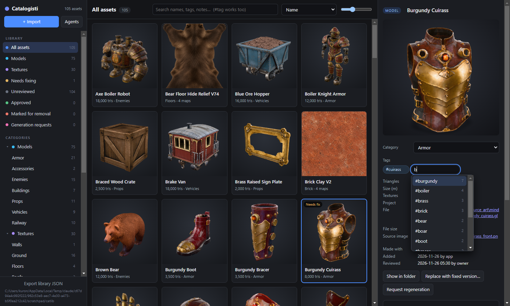

# Catalogisti

A desktop library for game 3D models and textures. Browse everything as rendered
thumbnails, review quality, tag and categorise assets, swap in fixed versions,
and let AI agents use the same library through an MCP server.



## Features

- **Models and Textures** as separate libraries. Models: weapon parts, armor,
  props, buildings, vehicles and more. Textures: walls, ground, floors, roofs,
  stone, brick, wood, metal… with their PBR maps (albedo, normal, roughness,
  AO, height, ORM) grouped into one entry.
- **Import** a folder of `.glb`/`.gltf` models, a folder of texture images, single
  files, or a shared texture library `catalog.json`. Categories and tags are
  guessed from file names and from `results.json` / `manifest.json` sidecars
  (Modly batches), triangles and size are measured from the GLB.
- **3D preview** (model-viewer, drag to rotate) and a **large view** with all stats
  (⤢ or double-click the preview).
- **Textures on a material ball**: the texture set on a rotating sphere or tile;
  the height map displaces the surface (depth slider) so relief/parallax shows.
- **Embedded texture sizes** of every GLB (e.g. 2 × 2048×2048 PNG) and
  **Shrink…** to rewrite them at 1024/512/256 px (optionally as JPEG); the
  original stays in the version history.
- **Organize files into folders**: `<Library>\<Project>\Models\<Category>` and
  `<Library>\<Project>\Textures\<Category>\<Texture>`; files outside the
  library folder are copied, inside it moved; undo available.
- **Ready vs unapproved**: Models/Textures and the category tree list approved
  assets; everything else is under Unapproved. Filter models by triangle count.
- **Tags**: hover a tag to delete it, `+` to add; typing suggests existing tags
  (`i` → `#iron`, `#item`). Click a tag in the sidebar to filter, or search `#tag`.
- **Categories work like tags**: an asset can be in several (e.g. Railway and
  Props); add, remove or invent categories with the same chip editor.
- **Quality review** saves itself as you click or type: Approved / Needs fix /
  Regenerate / Remove, problem flags (reduce triangles, duplicate, texture,
  scale, broken mesh) and notes that agents read.
- **Made from & versions**: the source images the model was generated from
  (front, back, side views…) and every earlier version, viewable in the preview;
  restore an earlier version with one click.
- **Variants**: link versions of the same model (TripoSG and TRELLIS results,
  raw and reduced, old and fixed); "Group variants" shows each set as one card.
- **Same-name check**: importing a model whose name already exists asks what to
  do. Byte-identical files are merged into one asset with both locations;
  different files can be linked as variants or kept apart.
- **Replace with fixed version**: swaps the file, keeps the old file and its
  review in the version history.
- **Delete** removes one model or texture set from the catalog, or, if it is
  linked, optionally all its variants. Files stay on disk unless you tick
  "move to Recycle Bin"; source images are never deleted.
- **Generation requests**: ask for a new asset or a fixed version; agents pick
  them up through MCP.
- **Sources**: the sidebar lists every folder the library reads from. Only
  ticked folders are shown (in the app and to agents); untick one to hide its
  models while keeping their reviews. Hover a source and click × to stop reading from it (its assets leave the catalog,
  files stay on disk), or **Clear all…** to start an empty library and import
  new folders. Reviews, notes and tags are remembered and return if the same
  files are imported again.
- Everything is saved immediately to one file, `library.json`, in
  `%APPDATA%\Catalogisti\library` (override with `CATALOGISTI_DATA`). Changes made
  by agents show up in the open app automatically.

## Run

Download `Catalogisti-<version>-portable.exe` from the Releases page and start it,
or from source:

```powershell
npm install
npm start
```

Build the portable exe yourself with `npm run dist` (output in `dist/`).

## MCP server for agents

Click **Agents** in the app to copy the exact configuration. It looks like:

```json
{
  "mcpServers": {
    "catalogisti": {
      "command": "node",
      "args": ["C:/path/to/Catalogisti/resources/mcp/server.js"],
      "env": { "CATALOGISTI_DATA": "C:/Users/<you>/AppData/Roaming/Catalogisti/library" }
    }
  }
}
```

Node.js must be on the PATH. Tools:

| Tool | Use |
| --- | --- |
| `catalog_summary` | Counts, assets needing fixes, open requests |
| `list_sources` | Folders the library reads from |
| `search_assets` | Search by text, `tags` (all), `any_tags`, kind, category, review, `needs_fix` |
| `get_asset` | Full record: file, maps, triangles, source image/prompt, versions, review notes |
| `find_or_request` | Find a usable asset for a need; if none, open a request with instructions |
| `list_tags`, `list_categories` | Reuse existing tags and categories |
| `set_review` | Decision, flags, notes, or `append_note` for a dated finding |
| `edit_tags`, `edit_categories`, `update_asset` | Tag, categorise (several categories allowed), rename |
| `link_variants`, `unlink_variant`, `resolve_duplicate` | Variant groups and same-name pairs (merge / link / keep) |
| `add_asset` | Register a generated GLB or texture (`request_id`, or `replaces` for a fixed version) |
| `request_asset`, `list_requests`, `update_request` | Generation work queue |
| `delete_asset` | Remove from the catalog (the file stays on disk) |

New models are generated with the Modly MCP (image-to-3D), reduced to the
triangle budget, exported as GLB and registered with `add_asset`.

## Tests

```powershell
npm test
```

## Licence

MIT. `src/model-viewer.umd.js` is Google's model-viewer (Apache-2.0).
